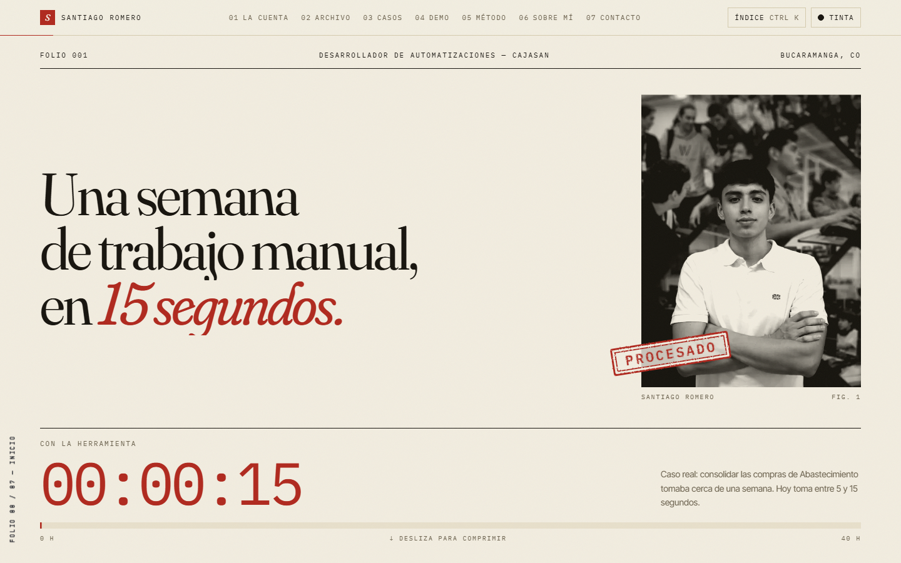
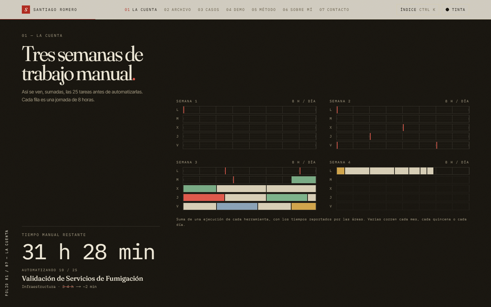
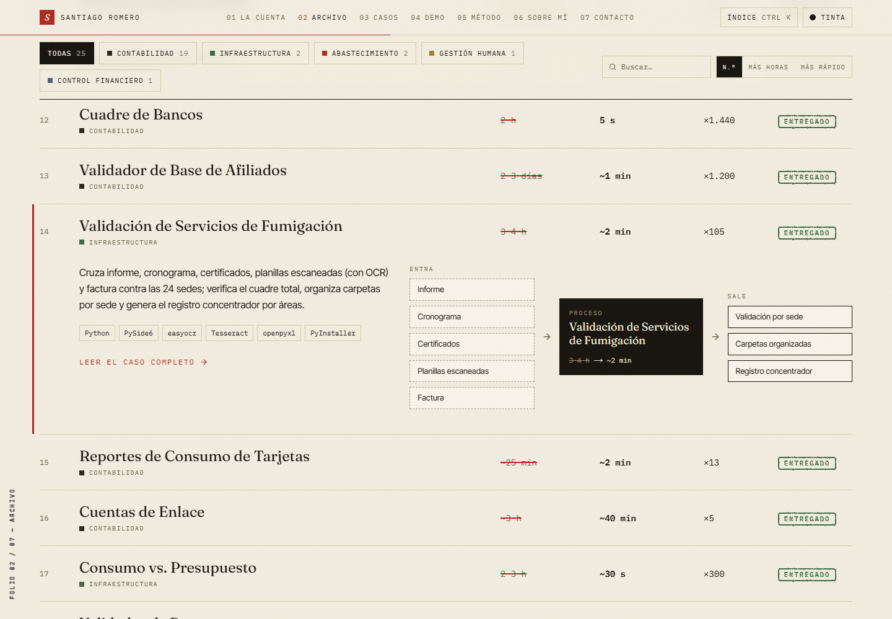
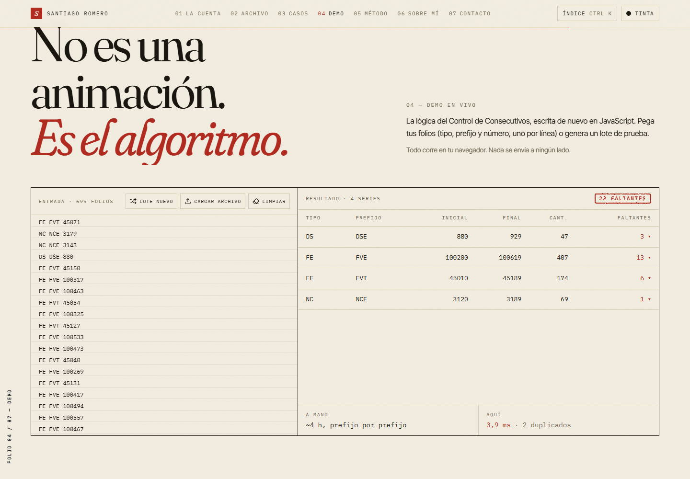
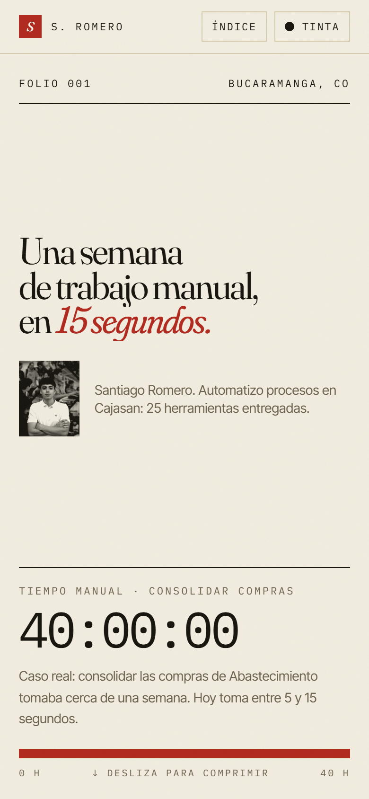

<div align="center">



# Una semana de trabajo manual, en 15 segundos.

**Portafolio de Santiago Romero, desarrollador de automatizaciones en Cajasan.**<br />
25 herramientas entregadas, contadas con los tiempos reales que reportó cada área.

[](https://github.com/SantiagoRomero7/portafolio-automatizacion/actions/workflows/ci.yml)


</div>

---

## La idea

La mayoría de portafolios se parecen: tarjetas, barras de habilidades al 95 % y métricas redondas que nadie puede
verificar. Este se diseñó al revés.

Mi trabajo es convertir procesos manuales de horas o días en segundos, así que el sitio **cuenta tiempo**. Su lenguaje
visual sale del mundo donde viven esas herramientas, la contabilidad: papel, tinta, un libro mayor y un sello rojo de
«procesado». Y cada cifra que aparece en pantalla sale del registro de entregas, no de la imaginación.

> Sumadas, una ejecución de cada herramienta equivale a **tres semanas de trabajo manual**.
> Automatizadas, requieren **poco más de una hora** de atención humana.

## Recorrido

| Sección | Qué pasa |
| --- | --- |
| **Portada** | Un reloj que, con el scroll, baja de `40:00:00` a `00:00:15`: el caso real del Consolidador de Compras. Al llegar, cae un sello sobre la foto. |
| **La cuenta** | Las 25 herramientas dibujadas como jornadas de 8 horas. Al avanzar, cada tarea se automatiza y el calendario se vacía en vivo. |
| **El Archivo** | El registro completo como libro contable: el *antes* tachado en rojo, el *después* al lado. Filtros por área, búsqueda, orden y totales que se recalculan. Cada fila se abre en un diagrama de entradas → proceso → salidas. |
| **Casos** | Cinco herramientas contadas a fondo: el problema, cómo se hacía, qué construí y el detalle técnico. |
| **Demo** | La lógica real del *Control de Consecutivos*, portada a JavaScript. Pegas folios o arrastras un `.txt`/`.csv` y detecta faltantes y duplicados en milisegundos, sin salir del navegador. |
| **Método** | Cuatro pasos de trabajo. Cada herramienta indica en cuántas entregas aparece y, al tocarla, filtra el archivo. |
| **Índice** | Paleta de comandos con <kbd>Ctrl</kbd> <kbd>K</kbd> / <kbd>⌘</kbd> <kbd>K</kbd> para saltar a cualquier sección, herramienta o acción. |
| **Papel / Tinta** | Tema claro y oscuro; en modo tinta los paneles se imprimen en papel. |

<table>
  <tr>
    <td width="50%"></td>
    <td width="50%"></td>
  </tr>
  <tr>
    <td width="50%"></td>
    <td width="50%" align="center"></td>
  </tr>
</table>

## Decisiones de diseño

- **Ningún número decorativo.** Todo sale de [`src/data/automations.ts`](src/data/automations.ts), la transcripción
  del registro de entregas. Los totales, el calendario, el índice y el método se calculan a partir de ahí.
- **Confidencialidad.** Solo se nombra a Cajasan. Los sistemas internos aparecen con nombres genéricos (*el ERP*,
  *la maestra de personas*, *el sistema POS*), sin códigos de cuenta, nombres de archivo ni datos reales. Los datos de
  la demo son sintéticos. El código de las herramientas vive en la red interna; este repositorio es solo el portafolio.
- **Identidad «libro mayor».** Fraunces para titulares, Inter Tight para texto e IBM Plex Mono para cifras. Paleta de
  papel `#f2ede0`, tinta `#16130d` y sello `#b0281d`. Los sellos tienen bordes irregulares gracias a un filtro SVG
  (`feTurbulence` + `feDisplacementMap`) y la foto se imprime en dos tintas con otro filtro SVG.
- **Movimiento con propósito.** Las animaciones de scroll comunican una idea, la compresión del tiempo, y no están
  ahí de adorno. Se respeta `prefers-reduced-motion`, las secciones animadas tienen un resumen para lectores de pantalla
  y todo es navegable con teclado.
- **Liviano.** Sin librerías de 3D ni de gráficos: el calendario, las barras y los diagramas son HTML y CSS.

## Stack

| Capa | Herramientas |
| --- | --- |
| Framework | [Next.js 16](https://nextjs.org) (App Router, Turbopack) · React 19 |
| Lenguaje | TypeScript en modo estricto |
| Estilos | Tailwind CSS 4 con tokens propios en CSS · `next/font` |
| Movimiento | Framer Motion (`useScroll`, `useTransform`, `AnimatePresence`) |
| Calidad | ESLint · `next typegen` + `tsc` · GitHub Actions |

## Estructura

```text
src/
├── app/
│   ├── layout.tsx          # Fuentes, metadatos y filtros SVG compartidos (sello y duotono)
│   ├── page.tsx            # Composición de las secciones
│   └── globals.css         # Tokens de color, tema tinta y utilidades del libro mayor
├── components/
│   ├── Nav.tsx             # Barra superior, progreso de lectura y folio lateral
│   ├── CommandPalette.tsx  # Índice con Ctrl/⌘ + K
│   ├── ui.tsx              # Sello, revelados y titulares con máscara
│   └── sections/           # Hero, Week, Archive, Cases, Demo, Method, About, Contact
├── data/
│   ├── automations.ts      # Registro de las 25 herramientas (fuente de todas las cifras)
│   ├── cases.ts            # Los cinco casos de estudio
│   └── contact.ts
└── lib/
    ├── format.ts           # Duraciones, reloj y normalización de texto
    └── site.ts             # Secciones, eventos entre componentes y tema
```

## Correrlo localmente

Requiere Node.js 20.9 o superior.

```bash
git clone https://github.com/SantiagoRomero7/portafolio-automatizacion.git
cd portafolio-automatizacion
npm install
npm run dev
```

Abre [http://localhost:3000](http://localhost:3000).

| Script | Qué hace |
| --- | --- |
| `npm run dev` | Servidor de desarrollo |
| `npm run build` | Build de producción |
| `npm run start` | Sirve el build de producción |
| `npm run lint` | ESLint |
| `npm run typecheck` | Genera los tipos de rutas y corre `tsc --noEmit` |

**Variables de entorno (opcional).** `NEXT_PUBLIC_SITE_URL` define la URL pública del sitio para que las vistas
previas al compartir el enlace (Open Graph) resuelvan bien la imagen.

## Agregar una automatización

Cada entrega es un objeto en [`src/data/automations.ts`](src/data/automations.ts):

```ts
{
  n: 26,
  id: "mi-herramienta",
  name: "Mi herramienta",
  area: "Contabilidad",
  what: "Qué hace, en una o dos frases.",
  before: "~2 h",       // como lo reportó el área
  after: "10 s",
  beforeMin: 120,       // minutos de trabajo humano antes…
  afterMin: 10 / 60,    // …y después
  stack: ["Python", "openpyxl"],
  status: "Entregado",
  inputs: ["Archivo de entrada"],
  outputs: ["Archivo de salida"],
}
```

Con eso, la portada, *La cuenta*, el archivo, sus totales, el índice y el método se actualizan solos.

## Licencia

El código se publica bajo [licencia MIT](LICENSE). Los textos, la fotografía y los casos descritos son contenido
personal © 2026 Santiago Romero y no forman parte de esa licencia.

## Contacto

**Santiago Romero** · Bucaramanga, Colombia<br />
[santirmrm420@gmail.com](mailto:santirmrm420@gmail.com) ·
[LinkedIn](https://www.linkedin.com/in/santiago-romero-9a673a37a/) ·
[GitHub](https://github.com/SantiagoRomero7)
